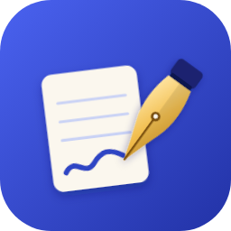

# Plume

Prise de notes manuscrites façon GoodNotes : carnets, PDF annotables, tableaux blancs, documents texte, audio synchronisé, comptes et synchronisation entre appareils. Fonctionne hors connexion.

**Version actuelle : 2.5** — Documents texte façon Word (ruban, polices, couleurs, styles, tableaux, table des matières, notes, en-tête/pied, export .docx) et IA au choix : Claude, ChatGPT, Gemini, Mistral, Groq, OpenRouter, DeepSeek, Grok, Ollama…

| Appareil | Téléchargement |
|---|---|
| Android | [Plume.apk](releases/Plume.apk?raw=1) |
| Windows (installateur) | [Plume-Setup.exe](win/Plume-Setup-2.5.0.exe?raw=1) |
| Windows (portable, sans installation) | [Plume-portable.exe](releases/Plume-portable.exe?raw=1) |

Une nouvelle version s'installe par-dessus l'ancienne : les notes sont conservées. L'appli prévient quand une nouvelle version sort.
